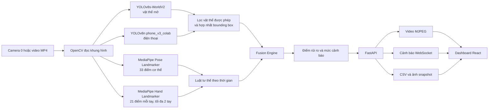

# TỔNG QUAN HỆ THỐNG HỖ TRỢ GIÁM SÁT GIAN LẬN THI CỬ — EXAMGUARD

> **Đề tài:** Nghiên cứu ứng dụng thuật toán YOLO và framework MediaPipe trong hệ thống giám sát phát hiện gian lận thi cử  
> **Đơn vị:** Khoa Công nghệ thông tin, Trường Đại học Tài nguyên và Môi trường Hà Nội  
> **Phạm vi tài liệu:** Tổng hợp theo mã nguồn, cấu hình và kết quả thực nghiệm đang có trong workspace, cập nhật đến tháng 09/2026.  
> **Lưu ý:** Hệ thống tạo tín hiệu để giám thị kiểm tra, không tự động kết luận hoặc xử lý kỷ luật thí sinh.

## 1. Giới thiệu bài toán

### 1.1. Bối cảnh

Trong một ca thi, giám thị phải quan sát đồng thời nhiều vị trí và khó theo dõi liên tục mọi chi tiết trên video. ExamGuard được xây dựng như một nguyên mẫu hỗ trợ: tiếp nhận hình ảnh từ camera hoặc video, phát hiện vật thể và tư thế đáng chú ý, sau đó gửi cảnh báo kèm thời điểm và ảnh chụp để con người xem lại.

### 1.2. Mục tiêu

- Phát hiện sự xuất hiện của **điện thoại** và một số vật thể cần rà soát như sách hoặc tài liệu ẩn.
- Trích xuất dấu hiệu hình học liên quan đến **quay đầu, cúi đầu, tay gần tai và vị trí tay bất thường**.
- Kết hợp tín hiệu theo thời gian để hạn chế cảnh báo do một khung hình nhiễu.
- Hiển thị video có chú thích, mức rủi ro, lịch sử cảnh báo và ảnh chụp sự kiện trên dashboard web.

### 1.3. Bối cảnh áp dụng và quy mô hiện tại

Workspace chưa có bằng chứng cho thấy hệ thống đã được triển khai hoặc nghiệm thu tại **một phòng thi cụ thể**. Phạm vi đã kiểm tra là:

- một nguồn video hoặc webcam chỉ số 0;
- một người trong khung hình;
- sáu video thử nghiệm một người, một camera, độ phân giải 720 × 1280, 30 FPS, tổng thời lượng khoảng 193,63 giây;
- chưa theo dõi danh tính và chưa gán cảnh báo cho nhiều thí sinh trong cùng phòng.

Vì vậy, cách mô tả phù hợp ở giai đoạn hiện tại là **nguyên mẫu hỗ trợ giám sát quy mô một người/một camera**, chưa phải hệ thống giám sát toàn phòng thi.

## 2. Kiến trúc hệ thống

### 2.1. Luồng xử lý

1. **Nhận dữ liệu:** OpenCV mở webcam hoặc video, lấy timestamp theo nguồn video; camera trực tiếp dùng đồng hồ đơn điệu.
2. **Phát hiện vật thể:** YOLO-World tìm vật thể theo danh sách prompt. Checkpoint YOLOv8n chuyên biệt chạy riêng để phát hiện điện thoại.
3. **Phân tích cơ thể và tay:** MediaPipe Pose và Hands trích xuất landmark của một người và tối đa hai bàn tay.
4. **Kết hợp bằng chứng:** Fusion Engine áp dụng ngưỡng hình học, tính liên tục theo thời gian, điểm rủi ro và cơ chế giảm điểm.
5. **Cảnh báo:** backend ghi CSV, lưu snapshot cho sự kiện cần thiết, phát thông báo qua WebSocket và truyền video có chú thích bằng MJPEG.
6. **Giám thị xác minh:** dashboard hiển thị nguồn, model, FPS, mức rủi ro, lịch sử và ảnh sự kiện. Quyết định cuối cùng thuộc về giám thị.

### 2.2. Đối tượng YOLO theo dõi

| Nhánh | Đối tượng |
|---|---|
| YOLO-World — cần rà soát | `cell phone`, `smartphone`, `earphone`, `earbud`, `wireless earphone`, `cheat sheet`, `hidden note`, `book` |
| YOLO-World — vật được phép để loại trừ nhầm | máy tính khoa học/Casio, hộp bút, sổ, bìa hồ sơ, hộp, bút, tẩy, thước, chai nước |
| YOLOv8n chuyên biệt | một lớp duy nhất: `phone` |

Nhãn tai nghe hiện chỉ được vẽ để người dùng xem lại, **không tự tạo cảnh báo gian lận**, vì chưa có bộ phân loại tai nghe độc lập đủ tin cậy.

### 2.3. Cơ chế cảnh báo

| Sự kiện | Điểm |
|---|---:|
| Phát hiện điện thoại | 12 |
| Phát hiện sách/tài liệu cần rà soát | 8 |
| Quay đầu/nhìn sang bên | 5 |
| Cúi đầu kéo dài | 4 |
| Tay gần tai | 4 |
| Tay ở vị trí bất thường | 4 |

Mức tổng hợp: `OK` dưới 2 điểm, `LOW` từ 2, `MEDIUM` từ 6, `HIGH` từ 9 và `CRITICAL` từ 18 điểm. Tổng điểm được giới hạn ở 30; mỗi loại sự kiện chỉ cộng tối đa một lần trong một giây nguồn và điểm giảm dần khi không có bằng chứng mới. Thông báo cùng loại có cooldown 10 giây để tránh dồn dập.

## 3. Thuật toán và model cụ thể

### 3.1. Model sử dụng

| Thành phần | Phiên bản/cấu hình hiện hành | Vai trò |
|---|---|---|
| YOLO-World | `yolov8s-worldv2.pt` | Phát hiện zero-shot các vật thể cần rà soát và vật được phép |
| Phone detector | YOLOv8n fine-tuned, checkpoint `phone_v3_colab/weights/best.pt` | Phát hiện bounding box điện thoại; confidence tối thiểu 0,30 |
| MediaPipe | MediaPipe Tasks 0.10.32 | Backend landmark mặc định |
| Pose | Pose Landmarker Lite, 33 landmark, tối đa 1 người | Mũi, mắt, tai, vai, cổ tay, hông và các điểm cơ thể khác |
| Hands | Hand Landmarker, 21 landmark mỗi tay, tối đa 2 tay | Cổ tay và đầu ngón phục vụ luật tay gần tai |
| Đối chứng tư thế | `yolov8n-pose.pt` | Backend tùy chọn để so sánh, không phải backend mặc định |

Hệ thống **không dùng Face Mesh** trong pipeline hiện hành.

### 3.2. Logic phát hiện điện thoại

- YOLO-World chạy ở confidence chung 0,25; riêng nhãn điện thoại của World cần ít nhất 0,40.
- YOLOv8n chuyên biệt chạy ở confidence 0,30 và NMS IoU 0,45; bounding box và confidence cuối của điện thoại lấy từ model chuyên biệt.
- Kết quả World được ghép với box phone khi IoU từ 0,20 hoặc tâm box World nằm trong box phone; box trùng được loại nếu IoU trên 0,30.
- Nếu model chuyên biệt thấy điện thoại nhưng World bỏ sót, kết quả phone vẫn có thể được giữ.
- Một điện thoại chỉ tạo sự kiện sau ít nhất **3 quan sát**, kéo dài ít nhất **0,2 giây**, có ghép vị trí một-một. Khoảng gián đoạn lớn hơn 0,5 giây làm mất tính liên tục.

### 3.3. Định nghĩa các hành vi cần rà soát

| Hành vi/sự kiện | Định nghĩa triển khai | Ý nghĩa đúng khi trình bày |
|---|---|---|
| Dùng điện thoại | Bounding box phone vượt ngưỡng và đạt điều kiện liên tục theo thời gian | Bằng chứng vật thể mạnh, nhưng vẫn cần giám thị kiểm tra |
| Quay đầu/nhìn sang bên | Độ lệch mũi so với tâm hai mắt chia cho khoảng cách hai mắt lớn hơn 0,58; duy trì xấp xỉ 0,27 giây | Dấu hiệu quay đầu, không đồng nghĩa chắc chắn nhìn bài bạn |
| Cúi đầu lâu | Mũi thấp hơn đường mắt theo tỷ lệ trên 0,5 so với khoảng cách mũi–vai; duy trì xấp xỉ 0,4 giây | Có thể là viết bài bình thường; chỉ là tín hiệu hỗ trợ |
| Tay gần tai | Khoảng cách tay–tai nhỏ hơn 0,45 bề rộng vai, hoặc ngưỡng tuyệt đối 0,18 khi thiếu điểm vai; giữ 2 giây hoặc lặp 3 lần trong 20 giây | Gợi ý cần kiểm tra tai nghe; không phải nhận diện tai nghe |
| Tay bất thường | Cổ tay nằm thấp hơn vùng hông theo ngưỡng hình học 0,15 | Heuristic thăm dò, chưa có đánh giá hành vi độc lập |
| Sách/tài liệu | YOLO-World trả nhãn `book`, `cheat sheet` hoặc `hidden note` | Cần xét quy chế môn thi; sách/giấy không mặc nhiên là gian lận |

Hệ thống hiện **không có model đã huấn luyện riêng cho “nhìn bài bạn” hoặc “trao đổi tay”**. Hai hành vi này chỉ có thể được xem là giả thuyết từ tín hiệu tư thế và phải do con người xác minh.

## 4. Dataset

### 4.1. Dữ liệu huấn luyện và validation cho điện thoại

| Nội dung | Thông tin |
|---|---|
| Nguồn | CITW (Cellphones in the Wild), được mô tả là tập con điện thoại từ COCO 2017 |
| Train | 1.600 ảnh, 2.177 bounding box `phone` |
| Validation | 214 ảnh, 262 bounding box `phone` |
| Định dạng nhãn | YOLO bounding box: `class_id x_center y_center width height`, tọa độ chuẩn hóa |
| Audit cấu trúc | Không có ảnh thiếu nhãn, không có dòng nhãn sai cấu trúc và không có tệp trùng byte giữa train/validation theo công cụ audit hiện có |
| Huấn luyện | YOLOv8n pretrained, 40 epoch, ảnh 640, batch 16, seed 42, Google Colab |

Đây là ảnh đời thường, không phải dữ liệu phòng thi. Tập validation cũng đã được dùng trong quá trình chọn checkpoint, vì vậy không được gọi là tập test độc lập.

### 4.2. Dữ liệu video tự thu thập

Workspace có sáu clip một người/một camera: bình thường, viết bài, dùng máy tính, dùng hộp bút/sổ, điện thoại rõ và điện thoại khó. Các video này được giữ ngoài tập huấn luyện. Hai video có điện thoại đã được đánh dấu sơ bộ theo khoảng thời gian bằng cách rà khung hình mỗi 0,25 giây:

- `05_dien_thoai_ro`: 1 episode, từ 9,25 đến 25,50 giây;
- `06_dien_thoai_kho`: 3 episode, từ 4,75–12,00; 24,75–40,50; 44,50–46,60 giây.

Nhãn video đang ở trạng thái **provisional visual review**; nhóm cần xác nhận lại người gán nhãn, mốc thời gian và quyền sử dụng trước khi dùng làm kết quả nghiệm thu chính thức. Các hành vi khác như quay đầu, cúi đầu, tay gần tai và sách/tài liệu chưa có nhãn độc lập đầy đủ.

## 5. Kết quả thực nghiệm

### 5.1. Kết quả checkpoint từ quá trình huấn luyện

Checkpoint tốt nhất được lưu tại epoch 39 trên validation của Colab:

| Precision | Recall | mAP@0.5 | mAP@0.5:0.95 |
|---:|---:|---:|---:|
| 59,457% | 51,497% | 50,806% | 30,615% |

Các số này là kết quả validation của lượt huấn luyện, không phải độ chính xác trong phòng thi.

### 5.2. So sánh hai checkpoint trên cùng 214 ảnh validation

Điều kiện đo: confidence 0,30; NMS IoU 0,45; ghép dự đoán với nhãn ở IoU 0,50.

| Checkpoint | TP | FP | FN | Precision | Recall | F1 |
|---|---:|---:|---:|---:|---:|---:|
| phone v2 | 41 | 137 | 221 | 23,03% | 15,65% | 18,64% |
| phone v3 Colab — đang dùng | 124 | 78 | 138 | **61,39%** | **47,33%** | **53,45%** |

Không báo cáo `accuracy` vì bài toán phát hiện vật thể cần đánh giá theo bounding box và tập validation hiện chỉ chứa ảnh dương tính, khiến accuracy không có ý nghĩa đầy đủ.

Phân tích theo kích thước cho checkpoint Colab cho thấy recall đạt 24,18% với điện thoại rất nhỏ (dưới 0,25% diện tích ảnh), khoảng 52,70% với nhóm 0,25–1% và 64,95% với nhóm từ 1% trở lên. Điện thoại nhỏ là điểm yếu chính.

### 5.3. Kết quả trên sáu video thử nghiệm

| Video | FPS xử lý | Episode phone phát hiện | Cảnh báo phone ngoài khoảng nhãn |
|---|---:|---:|---:|
| Bình thường | 10,95 | 0/0 | 1 |
| Viết bài | 10,41 | 0/0 | 0 |
| Máy tính Casio | 9,69 | 0/0 | 3 |
| Hộp bút/sổ | 10,56 | 0/0 | 1 |
| Điện thoại rõ | 10,18 | 1/1 | 1 |
| Điện thoại khó | 9,65 | 3/3 | 0 |

Theo nhãn sơ bộ, hệ thống phát hiện **4/4 episode điện thoại**, độ trễ từ đầu episode đến cảnh báo đầu tiên khoảng **0,75–2,05 giây**, đồng thời tạo **6 cảnh báo điện thoại ngoài khoảng nhãn**. Không gọi 4/4 là accuracy 100% vì tập rất nhỏ, nhãn chưa được duyệt chính thức và còn cảnh báo nhầm. Các cảnh báo `HEAD_DOWN`, `CHEAT_SHEET` và `HAND_NEAR_EAR` chưa thể tính precision/recall vì chưa có ground truth hành vi.

Tốc độ **9,65–10,95 FPS** là tốc độ xử lý pipeline trên máy kiểm thử, không phải FPS camera và không phải độ trễ end-to-end của trình duyệt.

### 5.4. Kiểm thử phần mềm

- 63/63 kiểm thử hồi quy đạt tại lần xác minh gần nhất được ghi trong tài liệu dự án.
- Frontend build thành công; luồng video → phát hiện → cảnh báo → snapshot → API/dashboard đã chạy end-to-end.
- MediaPipe Pose + Hands đã nạp model thật và trả được 33 landmark cơ thể cùng 21 landmark cho mỗi bàn tay trên mẫu kiểm tra phù hợp.

Các kết quả này chứng minh tính hoạt động của phần mềm, không thay thế phép đánh giá độ chính xác nhận diện trong phòng thi.

## 6. Công nghệ và stack

| Lớp | Công nghệ |
|---|---|
| Ngôn ngữ | Python 3.14; JavaScript |
| Computer vision/ML | OpenCV 4.13.0.92, Ultralytics 8.4.23, PyTorch 2.10.0, TorchVision 0.25.0, MediaPipe 0.10.32 |
| Backend | FastAPI 0.138.1, Uvicorn 0.49.0, WebSocket |
| Frontend | React 19.2.0, Vite 8.1.0 |
| Truyền dữ liệu | MJPEG cho video; WebSocket cho trạng thái/cảnh báo; HTTP cho snapshot |
| Log/minh chứng | CSV, JSON, JPEG snapshot, biểu đồ PNG/PDF/SVG |

### Phần cứng đã ghi nhận

- **Máy kiểm thử cục bộ:** Lenovo model `21CQ002GUS`, CPU AMD Ryzen 5 PRO 6650U (6 nhân/12 luồng), RAM khoảng 16 GB, đồ họa tích hợp AMD Radeon. Kết quả video 9,65–10,95 FPS được đo trên máy này theo pipeline hiện hành.
- **Camera:** pipeline hỗ trợ webcam chỉ số 0 và đặt mục tiêu 1280 × 720, 30 FPS; model camera vật lý cụ thể chưa được ghi trong minh chứng.
- **Máy huấn luyện:** Google Colab, `device=0`; loại GPU thực tế của lượt train chưa có log xác minh, do đó không khẳng định T4 hay RTX 3060.

## 7. Hạn chế và hướng phát triển

### 7.1. Hạn chế hiện tại

1. **Chưa thử nghiệm tại phòng thi cụ thể:** sáu video chỉ là pilot một người/một camera, chưa đại diện cho ca thi thật.
2. **Chưa hỗ trợ nhiều thí sinh:** MediaPipe lấy người đầu tiên và không có ID tracking theo từng người.
3. **Dữ liệu lệch miền:** tập phone lấy từ COCO/CITW, khác góc camera, khoảng cách, ánh sáng và mức che khuất trong phòng thi.
4. **Validation chưa độc lập:** checkpoint được chọn trên chính tập 214 ảnh dùng để báo cáo so sánh.
5. **Cảnh báo nhầm còn đáng kể:** có 6 cảnh báo phone ngoài khoảng nhãn trên sáu video; máy tính và vật dụng hình chữ nhật dễ gây nhầm.
6. **Vật thể nhỏ còn yếu:** recall chỉ 24,18% khi điện thoại chiếm dưới 0,25% diện tích ảnh.
7. **Luật hành vi là heuristic:** quay đầu, cúi đầu hoặc tay gần tai không đủ chứng minh gian lận và chưa có ground truth hành vi đầy đủ.
8. **Chưa có phân loại trao đổi tay/nhìn bài bạn:** hệ thống mới nhận tín hiệu hình học, chưa có mô hình hành vi theo chuỗi thời gian.
9. **Hiệu năng hạn chế:** 9,65–10,95 FPS trên máy CPU hiện tại chưa đáp ứng đầy đủ video 30 FPS và chưa đo độ trễ trình duyệt end-to-end.
10. **Chưa có quản lý lịch sử dài hạn:** dashboard chủ yếu phục vụ phiên hiện tại; cấu hình từ giao diện và cơ chế tra cứu lâu dài còn hạn chế.

### 7.2. Hướng phát triển

- Thu thập và gán nhãn dữ liệu đúng bối cảnh phòng thi, có nhiều góc camera, khoảng cách, ánh sáng, vật che và mẫu âm tính khó.
- Tạo tập test độc lập theo người/phòng/phiên; dùng hai người gán nhãn và đo độ đồng thuận.
- Fine-tune detector cho vật thể nhỏ, bổ sung hard negatives và đánh giá theo kích thước, mAP, precision–recall và false alarms/hour.
- Thêm detector người và multi-object tracking để gắn sự kiện với từng thí sinh; sau đó mở rộng sang nhiều camera.
- Xây dựng mô hình hành vi theo chuỗi thời gian cho nhìn sang bài bên cạnh, trao đổi vật và dùng điện thoại, thay vì chỉ dùng ngưỡng từng frame.
- Hiệu chỉnh các ngưỡng và trọng số bằng tập validation phòng thi; báo cáo trade-off giữa recall, cảnh báo nhầm và độ trễ.
- Tối ưu suy luận bằng ONNX/TensorRT hoặc OpenVINO, lượng tử hóa và xử lý bất đồng bộ; benchmark riêng CPU/GPU và end-to-end.
- Hoàn thiện lưu trữ sự kiện, tìm kiếm lịch sử, cấu hình từ dashboard, phân quyền người dùng và cơ chế kiểm tra sức khỏe camera/model.
- Bổ sung quy trình bảo vệ dữ liệu cá nhân: thông báo ghi hình, thời hạn lưu, kiểm soát truy cập và xóa dữ liệu theo quy định.

## Nguồn minh chứng chính trong workspace

- Cấu hình và logic: `cheating-detection/src/config.py`, `yolo_detector.py`, `mediapipe_tasks_analyzer.py`, `mediapipe_analyzer.py`, `fusion_engine.py`, `temporal.py`.
- Dataset: `cheating-detection/artifacts/phone-v3-data-audit.json`.
- Cấu hình train: `cheating-detection/models/phone_v3_colab/args.yaml`, `results.csv`.
- Kết quả checkpoint: `cheating-detection/artifacts/phone-v3-colab-import.json`, `phone-colab-comparison.json`.
- Video pilot: `cheating-detection/artifacts/video-intake/manifest-eval.json`, `evaluation-final.json`, `evaluation-summary.md`.
