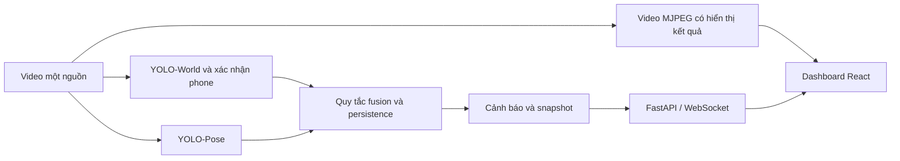

> Tài liệu trước đợt tích hợp MediaPipe và chuẩn hóa thời gian ngày 06/09. Các mô tả YOLO-Pose/đếm frame và số kiểm thử dưới đây là lịch sử. Xem REPORT_REVISED_2026-09-06.md và NEXT_STEPS_2026-09-07.md cho phiên bản hiện hành.

# Bản thảo kỹ thuật: hệ thống hỗ trợ giám sát thi qua phát hiện vật thể và tư thế

**Cập nhật hồ sơ:** người dùng xác nhận hạn cấp Trường 09/09/2026 và báo cáo đã nghiệm thu cấp Khoa có nội dung/số liệu tự tạo hoặc phóng đại. Bản thảo này là cơ sở chuẩn bị bản sửa theo minh chứng; cần nhóm/GVHD thống nhất cách đính chính bản đã nộp. Chưa xác nhận tên đăng ký cuối cùng, yêu cầu MediaPipe và mẫu hồ sơ. Chi tiết tại `docs/DOCUMENT_REVIEW_2026-09-06.md`.

**Trạng thái:** bản làm việc ngày 06/09/2026, chưa phải báo cáo hoàn chỉnh để nộp. Tiêu đề trên là mô tả tạm, không phải tên đề tài chính thức đã được phê duyệt. Đã nhận báo cáo có thông tin nhóm/GVHD và thông báo hạn hồ sơ giải thưởng 09/09/2026; chưa xác nhận nhóm thuộc đợt này, tên đăng ký và cách xử lý yêu cầu MediaPipe khác với mã hiện tại. Xem `docs/DOCUMENT_REVIEW_2026-09-06.md`. Các phần thực nghiệm video còn thiếu được ghi rõ, không điền bằng số liệu mô phỏng.

## Tóm tắt

Dự án xây dựng một nguyên mẫu hỗ trợ giám sát một người trong một nguồn video. Hệ thống kết hợp YOLO-World để phát hiện vật thể, một checkpoint YOLO chuyên phát hiện điện thoại, YOLO-Pose để trích xuất keypoint và các quy tắc tích lũy điểm để tạo cảnh báo. Giao diện React nhận video, trạng thái và sự kiện từ FastAPI qua MJPEG và WebSocket. Trong phép so sánh hai checkpoint trên cùng 214 ảnh validation chứa 262 điện thoại, tại confidence 0,30 và IoU matching 0,50, checkpoint huấn luyện trên Colab đạt precision 61,39%, recall 47,33% và F1 53,45%; checkpoint v2 đạt lần lượt 23,03%, 15,65% và 18,64%. Phân tích lỗi cho thấy recall của nhóm điện thoại có bbox dưới 0,25% diện tích ảnh là 24,18%, thấp hơn nhóm từ 1% diện tích ảnh trở lên là 64,95%. Kiểm thử tích hợp đã xác nhận luồng video, cảnh báo, snapshot và điều khiển phiên hoạt động. Tuy nhiên, tập validation đã được dùng để lựa chọn checkpoint, và chưa có video phòng thi độc lập có nhãn; vì vậy các kết quả hiện tại chưa chứng minh hiệu quả giám sát trong phòng thi.

**Từ khóa:** phát hiện vật thể; điện thoại; YOLO-World; tư thế; giám sát thi; đánh giá thực nghiệm.

## 1. Đặt vấn đề và mục tiêu

Trong phạm vi đề tài này, bài toán được định nghĩa là phát hiện các dấu hiệu trực quan cần người giám sát xem xét, chẳng hạn sự xuất hiện của điện thoại hoặc một số tư thế. Một vật thể xuất hiện hay một người nhìn xuống không tự nó chứng minh hành vi gian lận. Vì vậy, output của nguyên mẫu là cảnh báo kèm thời điểm và ảnh minh họa, không phải kết luận kỷ luật.

Mục tiêu trước mắt là hoàn thiện demo một nguồn video, một người, với model đúng nguồn gốc và phép đánh giá có thể chạy lại. Hai câu hỏi thực nghiệm được đặt ra: (1) checkpoint điện thoại nào hoạt động tốt hơn trên cùng tập ảnh đánh giá; (2) hệ thống kết hợp có phát hiện được các sự kiện mục tiêu trên video độc lập với mức bỏ sót, báo nhầm và độ trễ như thế nào. Hiện mới có bằng chứng cho câu hỏi thứ nhất và tính hoạt động của luồng phần mềm; câu hỏi thứ hai còn thiếu dữ liệu.

Phần việc đã thực hiện gồm tích hợp các thành phần có sẵn, sửa lỗi ngữ nghĩa nhãn và logic cảnh báo, xây dựng dashboard và bộ công cụ đánh giá có lưu nguồn gốc. Chưa có bằng chứng về tính mới của một thuật toán phát hiện hoặc tính ưu việt so với các công trình giám sát thi khác. Nội dung đóng góp khoa học cần được chốt theo đề cương và mở rộng thực nghiệm.

## 2. Cơ sở và thành phần kế thừa

YOLO-World là phương pháp phát hiện vật thể với tập nhãn mở, kết hợp thông tin thị giác và ngôn ngữ [1]. Dự án sử dụng checkpoint YOLO-World có sẵn với danh sách nhãn vật thể cần cảnh báo và vật thể được phép; không coi kiến trúc YOLO-World là đóng góp mới của đề tài.

COCO được xây dựng cho nhận biết vật thể trong các cảnh đời thường [2]. Bộ CITW được tác giả bộ dữ liệu mô tả là tập con điện thoại của COCO 2017 [3]. Trong dự án, dữ liệu này cung cấp nhãn phone rõ ràng hơn bộ dữ liệu cũ có lớp ProductRecog chưa được xác minh về ngữ nghĩa. Tuy nhiên, các ảnh đời thường không đại diện trực tiếp cho góc nhìn, khoảng cách và điều kiện phòng thi.

Bootstrap được dùng trong phân tích thăm dò để mô tả biến thiên của số liệu trên tập ảnh hiện có; các chỉ số hai model được giữ ghép cặp khi lấy lại mẫu [4]. Khoảng bootstrap không xử lý được thiếu dữ liệu miền đích hoặc thiên lệch chọn checkpoint trên cùng validation.

## 3. Phương pháp và hệ thống

### 3.1. Luồng xử lý

API đọc tuần tự khung hình, chạy detector vật thể mỗi ba frame và pose trên mỗi frame xử lý. Output vật thể được giữ để hiển thị ở các frame trung gian; chỉ các lần YOLO chạy mới được dùng để tăng số lần xác nhận điện thoại. Tư thế hiện lấy người đầu tiên model trả về, chưa có tracking định danh người. Vì vậy cấu hình này chỉ phù hợp với phạm vi demo một người đã chốt.

### 3.2. Xác nhận điện thoại

YOLO-World sử dụng ngưỡng riêng 0,40 cho nhãn điện thoại. Khi model phone nạp thành công, prediction của model đó ở confidence từ 0,30 được dùng để xác nhận box YOLO-World nếu IoU từ 0,20 hoặc tâm box World nằm trong box xác nhận. Model phone cũng có thể bổ sung điện thoại mà World bỏ sót, theo các điều kiện loại trùng và chồng lấn với vật được phép.

Một điện thoại cần được quan sát ở ba lần YOLO mới liên tiếp tại các box chồng lấn để được cộng điểm. Bộ ghép box dùng tương ứng một-một giữa hai lần quan sát, tránh việc điện thoại mới kế thừa bộ đếm của điện thoại khác. Đây là ghép vị trí ngắn hạn, không phải tracker định danh hoàn chỉnh; giao cắt, che khuất hoặc thay đổi vị trí mạnh vẫn là trường hợp cần đánh giá.

Quy tắc ưu tiên vật được phép khi box chồng lấn là heuristic hiện hữu, có thể bỏ sót điện thoại thật đặt gần hoặc trong đồ vật khác. Chưa có ablation định lượng để khẳng định heuristic này cải thiện tổng thể precision/recall.

### 3.3. Tư thế và điểm cảnh báo

Các điều kiện tư thế sử dụng vị trí và confidence của mắt, mũi, vai, cổ tay và hông. Thiếu keypoint mắt không được coi là bằng chứng quay đầu; mất người hoặc thiếu keypoint cần thiết làm reset bộ đếm tương ứng. Các ngưỡng hiện tại là tham số heuristic, chưa được hiệu chuẩn trên video phòng thi.

Mỗi lần có sự kiện, điểm được cộng theo trọng số cấu hình; điện thoại cộng 12 điểm. Mức LOW/MEDIUM/HIGH bắt đầu ở 2/6/9 điểm, CRITICAL từ 18 và tổng điểm giới hạn ở 30. Sau 30 frame liên tiếp không có sự kiện, điểm giảm một đơn vị ở mỗi frame sạch tiếp theo. Quy tắc này phụ thuộc FPS xử lý; không được mô tả là giảm theo một khoảng giây cố định.

API hạn chế lặp lại cùng loại cảnh báo trong 10 giây theo thời gian xử lý thực. Gửi WebSocket có timeout và xử lý lỗi riêng để client chậm không làm dừng detection. Dashboard phân biệt cấu hình model, model đã nạp, fallback và lỗi phiên; chỉ có file checkpoint chưa đủ để báo model đang chạy.

## 4. Dữ liệu và thiết kế thực nghiệm

### 4.1. Các checkpoint

| Checkpoint | Dữ liệu / ngữ nghĩa | Vai trò trong đánh giá |
|---|---|---|
| phone_v1 | Lượt cũ khai báo sai mapping lớp | Không dùng để kết luận chất lượng phone |
| phone_v2 | Giữ mapping gốc ProductRecog và phone, phone ở class 1 | Checkpoint đối chiếu |
| phone_v3_colab | Checkpoint Colab có class 0 = phone | Checkpoint được chọn cho demo sau kiểm thử tích hợp |

ZIP kết quả Colab chứa 40 epoch, thời gian tích lũy trong CSV là 994,254 giây. Cấu hình lưu trong ZIP: YOLOv8n pretrained, imgsz 640, batch 16, device 0, seed 42, patience 10. Best checkpoint lưu metrics tương ứng epoch 39. Không có bằng chứng để xác định loại GPU chỉ từ device 0, hoặc để so sánh thời gian Colab/CPU như một benchmark phần cứng được kiểm soát.

Bộ CITW cục bộ đã chuẩn bị 1.600 ảnh train và 214 ảnh validation. Đường dẫn dataset trong cấu hình Colab phù hợp tên bộ này, nhưng ZIP kết quả không chứa manifest checksum train trên Colab; chưa xác minh tính đồng nhất byte của toàn bộ ảnh train giữa hai máy. Các con số thực nghiệm bên dưới dùng tập validation cục bộ đã lưu checksum từng ảnh và nhãn.

### 4.2. Đánh giá detector riêng

Hai checkpoint được chạy trên cùng 214 ảnh, cùng imgsz 640, confidence 0,30, NMS IoU 0,45 và CPU. Matching prediction/ground truth sử dụng IoU 0,50; prediction được xét theo confidence giảm dần, mỗi nhãn và mỗi prediction chỉ khớp một lần. Chỉ tính lớp phone theo tên lớp của từng model để tránh nhầm class 0 của v2 với phone.

Precision = TP/(TP+FP); recall = TP/(TP+FN); F1 = 2TP/(2TP+FP+FN), tính từ tổng số box toàn tập. Mẫu số bằng 0 được quy ước chỉ số bằng 0. Đây là P/R/F1 ở một ngưỡng cố định, không phải mAP và không phải độ chính xác phân loại hành vi.

Phép bootstrap lấy lại mẫu 214 ảnh có hoàn lại, giữ nguyên mọi box và cặp output hai model trong mỗi ảnh. Với 2.000 lần lấy mẫu, seed 42, khoảng percentile 2,5–97,5 được báo như phân tích thăm dò. Đơn vị ảnh được giả định độc lập; chưa có grouping theo người/phiên/cảnh nên giả định này chưa được kiểm chứng.

### 4.3. Đánh giá video dự kiến

Sáu clip khoảng 30 giây gồm hai cảnh làm bài bình thường, hai cảnh dùng vật dễ nhầm và hai cảnh có điện thoại rõ/khó. Đây là pilot một người, không đủ để suy rộng cho nhiều thí sinh. Clip cần nhãn loại sự kiện và khoảng thời gian; chưa có video/nhãn nên chưa thực hiện phần này.

Chỉ số dự kiến: sự kiện được phát hiện/bỏ sót, cảnh báo ngoài khoảng nhãn, độ trễ tính từ thời điểm xuất hiện trên video và FPS xử lý. Công cụ hiện chưa đo trễ end-to-end qua trình duyệt. Nếu dùng clip để điều chỉnh ngưỡng, phải giữ clip/phiên khác cho đánh giá cuối; không đưa clip test hoặc crop từ validation vào train rồi báo lại trên cùng dữ liệu.

## 5. Kết quả hiện có

### 5.1. So sánh trên 214 ảnh

| Checkpoint | TP | FP | FN | Precision | Recall | F1 |
|---|---:|---:|---:|---:|---:|---:|
| phone_v2 | 41 | 137 | 221 | 23,03% | 15,65% | 18,64% |
| phone_v3_colab | 124 | 78 | 138 | 61,39% | 47,33% | 53,45% |

Khoảng bootstrap 95% của Colab: precision 53,88–68,82%; recall 41,15–53,33%; F1 47,32–59,23%. Kết quả khẳng định checkpoint Colab tốt hơn checkpoint v2 trên tập và cấu hình đã đánh giá; chưa cô lập được tác động của một thuật toán vì hai lượt train khác dữ liệu, batch và số epoch.

*Hình 1. P/R/F1 ở ngưỡng cố định trên tập validation; không phải kết quả kiểm thử độc lập trong phòng thi.*

### 5.2. Phân tích lỗi

| Tỷ lệ diện tích bbox / ảnh gốc | Số phone | TP | FN | Recall |
|---|---:|---:|---:|---:|
| Dưới 0,25% | 91 | 22 | 69 | 24,18% |
| Từ 0,25% đến dưới 1% | 74 | 39 | 35 | 52,70% |
| Từ 1% trở lên | 97 | 63 | 34 | 64,95% |

Các khoảng kích thước này do dự án định nghĩa để chẩn đoán, không phải thang COCO small/medium/large. Nhóm bbox nhỏ có recall thấp hơn, nhưng chưa thể quy nguyên nhân chỉ cho kích thước vì ánh sáng, độ che và kiểu thiết bị có thể đồng thời thay đổi.

Review bằng mắt của trợ lý trên 12 ảnh có nhiều lỗi ghi nhận prediction trên sách, vùng laptop, khung cửa và họa tiết chữ nhật; đồng thời có phone nhỏ, mỏng hoặc bị tay che bị bỏ sót. Một số thiết bị nguồn nhãn chưa rõ loại, cần người gán nhãn kiểm tra. Các ảnh này được chọn theo số lỗi cao, không phải mẫu ngẫu nhiên; không dùng chúng để ước lượng tỷ lệ nhầm của từng loại vật trong quần thể.

### 5.3. Kiểm thử phần mềm

Bộ kiểm thử hiện có 41 trường hợp đạt, gồm phân biệt nhãn, tính liên tục điện thoại, keypoint thiếu, lỗi model/camera, client WebSocket chậm, matching, công thức chỉ số và bootstrap ghép cặp. Frontend build thành công. Kiểm thử model thật trên một ảnh validation được chọn rồi lặp thành video xác nhận luồng cảnh báo/snapshot/MJPEG; kiểm tra trình duyệt xác nhận hiển thị model Colab và nút bắt đầu/dừng.

Các kiểm thử này không thay thế thực nghiệm phòng thi. FPS quan sát ở một thời điểm hoặc độ trễ trên video ảnh lặp không được dùng làm chỉ số tổng quát trong phần kết quả nghiên cứu.

## 6. Thảo luận và giới hạn

Tập 214 ảnh đã được dùng trong quá trình chọn best checkpoint Colab nên kết quả là validation, không phải test độc lập. Bootstrap không loại bỏ thiên lệch chọn model. Tập chỉ gồm ảnh có nhãn phone, thiếu cảnh âm tính độc lập; không có cơ sở báo tỷ lệ báo động nhầm trên cảnh không có điện thoại hoặc báo động nhầm/giờ trong phòng thi.

Các nguồn bất định khác gồm ảnh gần trùng chưa được kiểm chứng theo cảnh/người, lỗi hoặc phạm vi nhãn thiết bị, khác biệt phiên bản Ultralytics giữa Colab và máy đánh giá, và biến thiên giữa các lần train chưa được đo. Chưa có thí nghiệm ablation để định lượng đóng góp riêng của YOLO-World, xác nhận phone, persistence hoặc pose. Điểm theo frame và cooldown theo thời gian xử lý có thể làm kết quả thay đổi khi tốc độ xử lý đổi.

Do đó ưu tiên tiếp theo là có dữ liệu video độc lập và review nhãn, không tự tăng số epoch. Chỉ khi lỗi model được xác nhận mới thu thập ảnh mới tương ứng và chuẩn bị train bổ sung trên Colab. Những phần mở rộng như tracking nhiều người, nhiều camera và nghiệm thu sử dụng thực tế chưa được thực hiện.

## 7. Kết luận tạm thời

Nguyên mẫu đã tích hợp checkpoint Colab với luồng video và cảnh báo có kiểm thử; phép so sánh detector trên cùng dữ liệu có thể chạy lại và cho kết quả tốt hơn checkpoint v2. Các bằng chứng hiện tại hỗ trợ lựa chọn model cho demo và chỉ ra nhóm lỗi ưu tiên. Chưa đủ dữ liệu để kết luận hệ thống đạt yêu cầu giám sát trong phòng thi hoặc bài nghiên cứu đã hoàn thành.

## Tài liệu tham khảo

[1] T. Cheng và cộng sự, [“YOLO-World: Real-Time Open-Vocabulary Object Detection,” 2024](https://arxiv.org/abs/2401.17270).

[2] T.-Y. Lin và cộng sự, [“Microsoft COCO: Common Objects in Context,” 2014](https://arxiv.org/abs/1405.0312).

[3] RidgeRun.ai, [“Cellphones in the Wild (CITW),” dataset card](https://huggingface.co/datasets/ridgerun-ai/citw-v0.1), revision `f31df211860010059745ba29de06d06f16055c6e`.

[4] SciPy, [“scipy.stats.bootstrap,” tài liệu API](https://docs.scipy.org/doc/scipy/reference/generated/scipy.stats.bootstrap.html).

## Phụ lục: bằng chứng và phần còn thiếu

| Nội dung | Tệp hoặc tình trạng |
|---|---|
| Checkpoint Colab và metrics gốc | `models/phone_v3_colab`; `artifacts/phone-v3-colab-import.json` ghi trạng thái lúc nhập, trước kích hoạt demo |
| Kết quả từng ảnh, checksum, runtime | `artifacts/research/phone-comparison.json` |
| Bootstrap và bảng/biểu đồ | `artifacts/research/phone-bootstrap.json`, `phone-metrics.csv`, `phone-benchmark.png`, `phone-benchmark.pdf` |
| Phân tích lỗi và 12 phiếu | `artifacts/research/error-analysis/summary.json`, `ASSISTANT_REVIEW.md` |
| Tích hợp model thật | `artifacts/phone-colab-check-1788630321422196900/summary.json` |
| Kiểm thử mới nhất | `artifacts/error-analysis-tests.log` |
| Video độc lập, nhãn | Chưa có; mẫu tại `demo/recordings/manifest.json` |
| Tiêu đề chính thức, tác giả, hướng dẫn, mẫu trường, hạn nộp | Đã nhận thông tin nhóm/GVHD, bố cục báo cáo và lịch giải thưởng; cần xác nhận tên đăng ký, tình trạng nghiệm thu và hạn áp dụng. Thiếu mẫu poster/cam kết; xem bản đối chiếu tài liệu |
| Ngưỡng nghiệm thu, kết quả phòng thi, ablation | Chưa có |

**Trước khi nộp:** thay thông tin còn thiếu bằng dữ liệu thật, hoàn thiện thực nghiệm độc lập và review với giảng viên; không xóa các giới hạn nếu chưa có bằng chứng khắc phục. Bản thảo này không khẳng định tính mới hoặc hiệu quả vượt các công trình khác.
