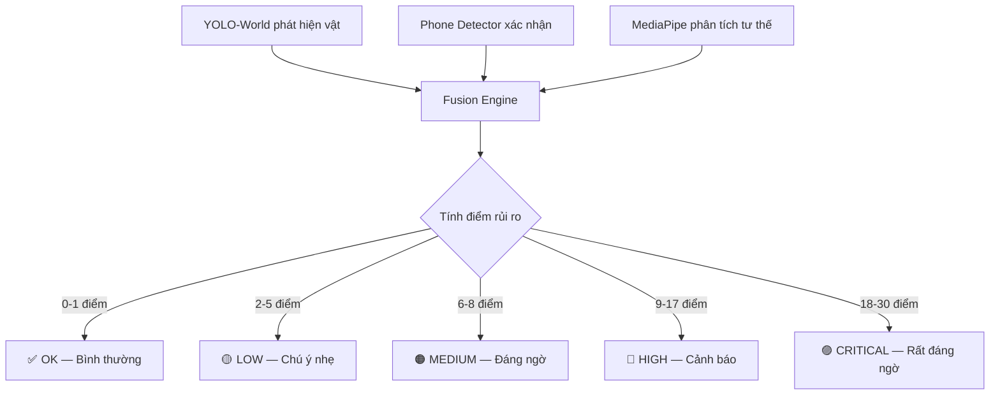
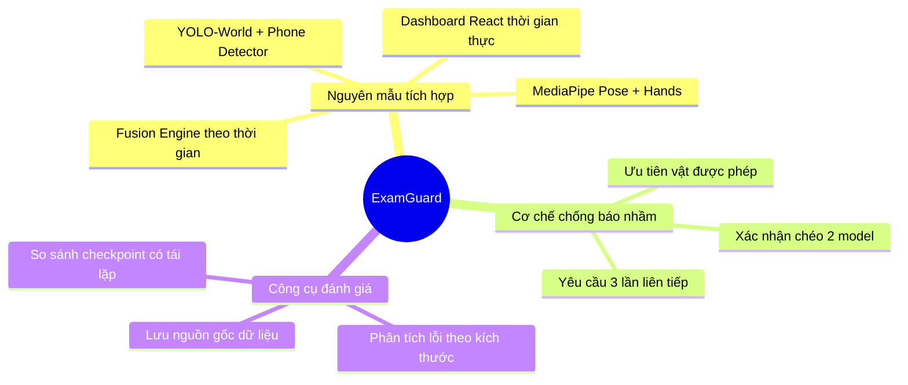

# 🎓 Tóm tắt đề tài NCKH: ExamGuard — Hệ thống hỗ trợ giám sát gian lận thi cử

> **Trường:** Đại học Tài nguyên và Môi trường Hà Nội — Khoa CNTT
> **Nhóm:** Vương Anh Vũ, Vũ Duy Tiến, Nguyễn Ngọc Anh, Nguyễn Thị Kim Tuyến, Nguyễn Thị Khánh Vân (Lớp ĐH13C8)
> **GVHD:** ThS. Cao Thị Thoa

---

## 1. Đề tài làm gì? (Nói ngắn gọn trong 30 giây)

Nhóm xây dựng một **phần mềm dùng AI để hỗ trợ giám thị phát hiện dấu hiệu gian lận trong phòng thi** — cụ thể là phát hiện **điện thoại** và các **tư thế đáng ngờ** (quay đầu, cúi đầu, tay gần tai…) qua camera.

> [!IMPORTANT]
> Phần mềm **không tự kết luận** ai gian lận. Nó chỉ **cảnh báo** giám thị: "Có dấu hiệu đáng chú ý tại thời điểm X" kèm ảnh chụp, để giám thị tự xác minh.

---

## 2. Hoạt động như thế nào? (Kiến trúc hệ thống)

Hệ thống gồm 3 tầng chính:

```
📷 Camera/Video ──▶ 🤖 AI phân tích ──▶ 📊 Dashboard giám sát
```

### Tầng 1: Đầu vào video
- Nhận video từ **webcam** hoặc **file video** có sẵn
- Xử lý từng khung hình (frame) theo thời gian thực

### Tầng 2: AI phân tích (chạy song song 3 mô hình)

| Mô hình | Công việc | Công nghệ |
|---------|-----------|-----------|
| **YOLO-World** | Phát hiện vật thể trong ảnh bằng mô tả ngôn ngữ (zero-shot) — tìm điện thoại, tai nghe, sách, tài liệu… | YOLOv8s-WorldV2 |
| **Phone Detector** | Model chuyên biệt chỉ để phát hiện điện thoại — dùng xác nhận lại kết quả YOLO-World, giảm nhầm | YOLOv8n fine-tuned trên tập CITW |
| **MediaPipe Pose + Hands** | Phân tích tư thế cơ thể (33 điểm) và bàn tay (21 điểm mỗi tay) | Google MediaPipe |

### Tầng 3: Fusion Engine — "Bộ não" kết hợp tất cả

Đây là phần logic cốt lõi. Nó **không chỉ nhìn 1 frame** mà theo dõi **liên tục theo thời gian**:



**Cách tính điểm:**
- Phát hiện điện thoại: **+12 điểm** (nặng nhất)
- Tài liệu/sách cấm: **+8 điểm**
- Quay đầu sang bên: **+5 điểm**
- Cúi đầu lâu: **+4 điểm**
- Tay gần tai (nghi tai nghe): **+4 điểm**
- Điểm **tự giảm dần** nếu không có dấu hiệu mới (mỗi giây sạch trừ 1 điểm)
- Tổng điểm **tối đa 30**, tránh tích luỹ vô hạn

**Cơ chế chống báo nhầm cho điện thoại:**
1. YOLO-World phát hiện "có vẻ là điện thoại" → Phone Detector kiểm tra lại
2. Phải **thấy 3 lần liên tiếp** ở cùng vị trí trong ≥ 0,2 giây mới tính
3. Nếu vật phát hiện **chồng lên vật được phép** (hộp bút, máy tính Casio…) → ưu tiên bỏ qua

### Tầng 4: Dashboard (giao diện người dùng)

- **Frontend:** React + Vite
- **Backend:** FastAPI (Python)
- **Giao tiếp:** Video truyền qua MJPEG, cảnh báo qua WebSocket (thời gian thực)
- Hiển thị: video có chú thích AI, lịch sử cảnh báo, ảnh chụp sự kiện, trạng thái model

---

## 3. Dữ liệu huấn luyện

| Thông tin | Chi tiết |
|-----------|----------|
| **Nguồn dữ liệu** | CITW (Cellphones in the Wild) — tập con điện thoại từ COCO 2017 |
| **Số lượng** | 1.600 ảnh train + 214 ảnh validation, nhãn: "phone" |
| **Kiến trúc model** | YOLOv8n (nano — nhỏ gọn) |
| **Huấn luyện** | 40 epoch, batch 16, imgsz 640, seed 42 trên Google Colab |
| **Thời gian train** | ~994 giây (~16,5 phút) trên Colab GPU |

> [!NOTE]
> Đây là ảnh đời thường (người cầm điện thoại trên phố, trong nhà…), **không phải ảnh phòng thi**. Vì vậy hiệu năng trong phòng thi thực tế có thể khác.

---

## 4. Kết quả đạt được

### 4.1. So sánh 2 checkpoint phát hiện điện thoại (trên 214 ảnh validation)

| Checkpoint | Precision | Recall | F1 |
|------------|-----------|--------|----|
| **v2** (train cũ, mapping lớp sai) | 23,03% | 15,65% | 18,64% |
| **v3 Colab** (đang dùng) | **61,39%** | **47,33%** | **53,45%** |

→ Checkpoint Colab **tốt hơn rõ rệt**: phát hiện đúng 124/262 điện thoại thay vì chỉ 41.

### 4.2. Phân tích lỗi — điện thoại nhỏ là điểm yếu chính

| Kích thước điện thoại | Recall |
|----------------------|--------|
| Nhỏ (< 0,25% diện tích ảnh) | **24,18%** — rất yếu |
| Trung bình (0,25% – 1%) | **52,70%** |
| Lớn (≥ 1%) | **64,95%** |

### 4.3. Kiểm thử phần mềm
- ✅ 57 test case đạt (logic fusion, matching, WebSocket, snapshot…)
- ✅ Luồng video → phát hiện → cảnh báo → dashboard hoạt động end-to-end
- ✅ MediaPipe Pose + Hands nạp và trả landmark thành công

---

## 5. Hạn chế (nhóm tự nhận — rất trung thực)

> [!WARNING]
> Nhóm ghi rõ nhiều hạn chế; đây là điểm đáng ghi nhận về tính trung thực khoa học.

| Hạn chế | Giải thích |
|---------|------------|
| **Chưa test trên video phòng thi thật** | 6 video độc lập dự kiến quay nhưng chưa có. Mọi số liệu đều trên ảnh COCO |
| **Chỉ 1 người, 1 camera** | Chưa tracking nhiều thí sinh, chưa phân biệt ai là ai |
| **Validation = Test** | Tập 214 ảnh vừa dùng chọn checkpoint vừa dùng báo cáo kết quả → có thiên lệch |
| **Ngưỡng chưa hiệu chỉnh** | Các tham số (điểm số, thời gian hold, khoảng cách tay-tai…) đặt theo kinh nghiệm, chưa tối ưu trên dữ liệu thật |
| **Luật tư thế là heuristic** | "Quay đầu" hay "cúi đầu" chỉ là hình học, chưa chứng minh = gian lận |
| **Chưa so sánh với nghiên cứu khác** | Không khẳng định ưu thế so với các hệ thống giám sát thi hiện có |

---

## 6. Đóng góp chính của đề tài



1. **Nguyên mẫu hoạt động end-to-end**: từ camera → AI → dashboard, có kiểm thử kỹ thuật
2. **Logic xác nhận theo thời gian**: không cảnh báo ngay khi thấy 1 frame có "điện thoại" — phải thấy 3 lần liên tiếp, cùng vị trí → giảm false positive
3. **Xác nhận chéo 2 model**: YOLO-World (zero-shot) + checkpoint chuyên biệt, giảm nhầm hộp bút/laptop thành điện thoại
4. **Công cụ đánh giá có lưu nguồn gốc**: so sánh checkpoint, phân tích lỗi, bootstrap — có thể chạy lại và kiểm chứng

---

## 7. Công nghệ sử dụng (tổng hợp)

| Thành phần | Công nghệ |
|------------|-----------|
| Phát hiện vật thể | YOLOv8s-WorldV2, YOLOv8n fine-tuned |
| Phân tích tư thế | MediaPipe Pose Landmarker + Hand Landmarker |
| Backend API | FastAPI (Python) |
| Frontend | React + Vite |
| Giao tiếp | MJPEG streaming + WebSocket |
| Huấn luyện | Google Colab (GPU) |
| Framework ML | Ultralytics, MediaPipe Tasks |

---

## 8. Tóm gọn nhất có thể

> **Một câu:** Nhóm xây phần mềm dùng AI (YOLO + MediaPipe) để phát hiện điện thoại và tư thế đáng ngờ qua camera, cảnh báo giám thị qua dashboard web thời gian thực — đã chạy được end-to-end nhưng chưa kiểm chứng trên phòng thi thật.

---

*Bản tóm tắt được tạo dựa trên mã nguồn, tài liệu kỹ thuật và báo cáo sửa đổi ngày 06/09/2026 của nhóm.*
